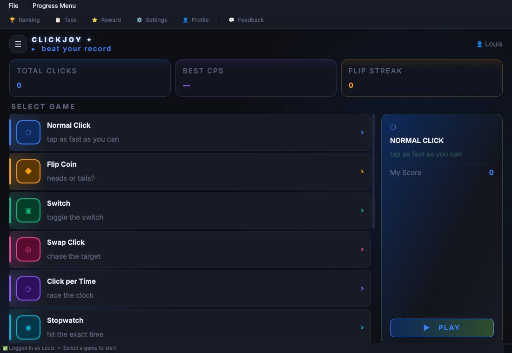
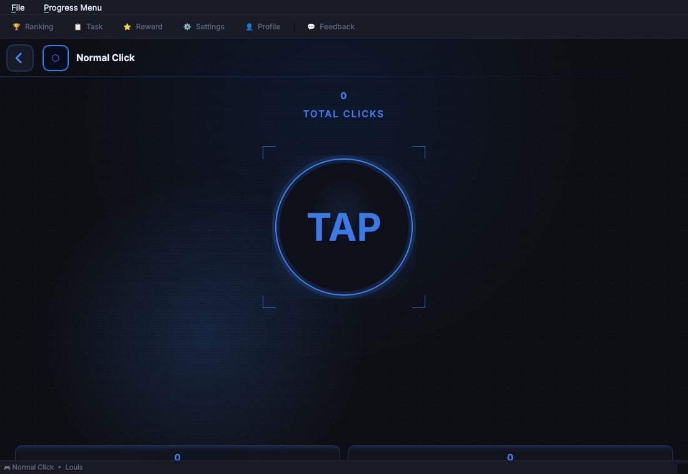
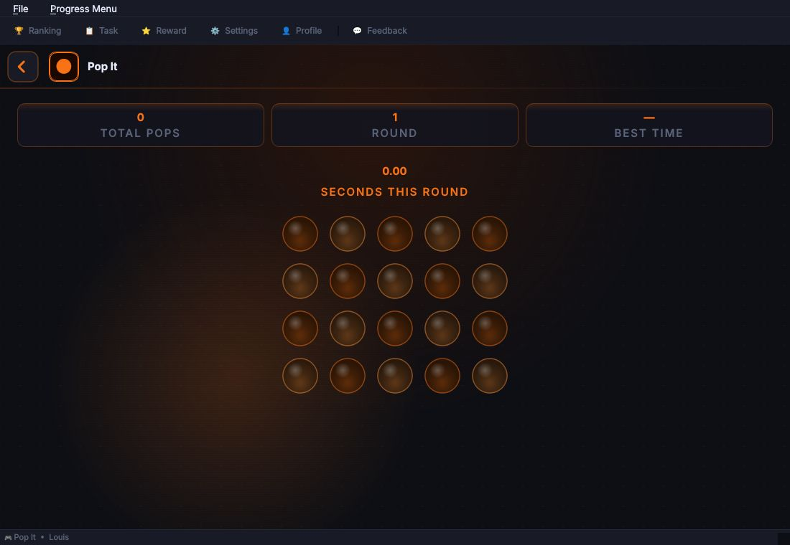
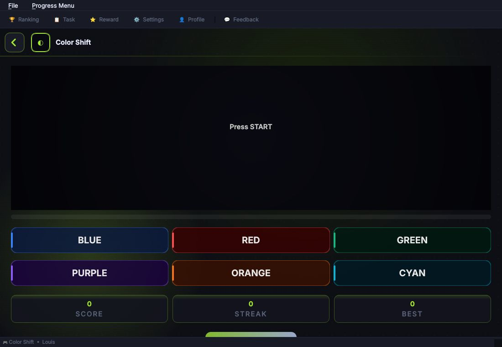
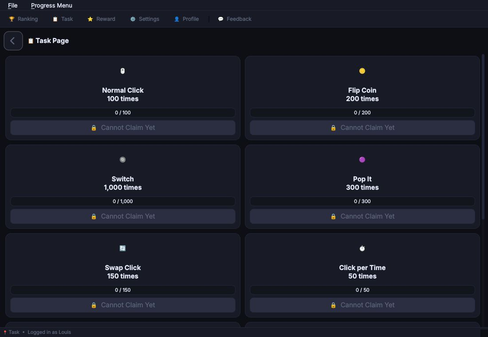
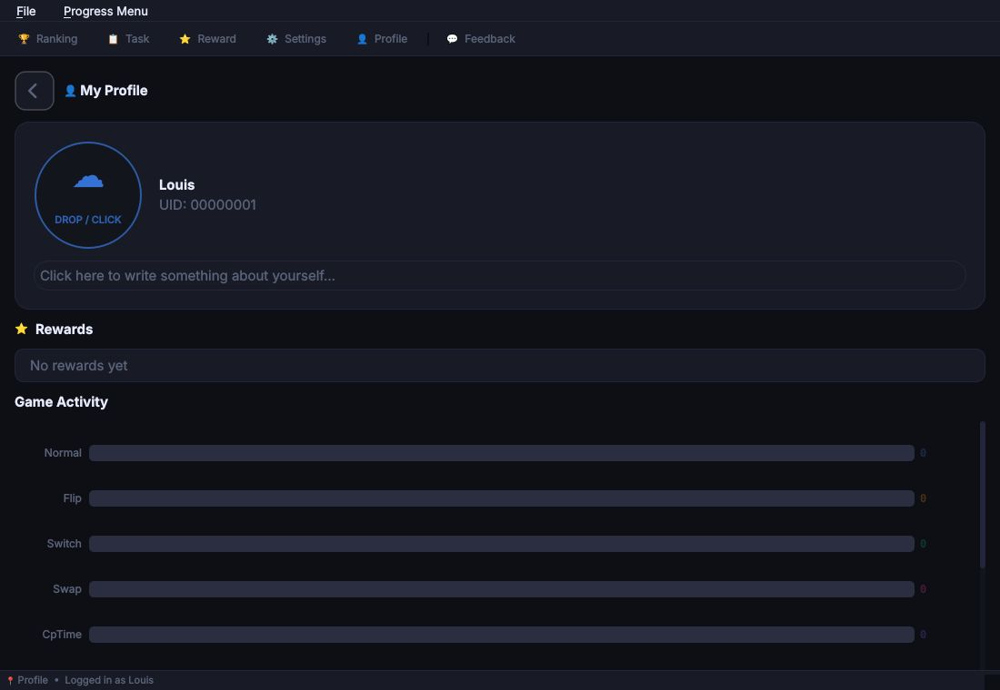

# ClickJoy

**An interactive clicking game for fun and fast reactions.**

ClickJoy is a click-based relaxation app with satisfying mini-interactions, made to help people relieve stress and pass time. A built-in score, task and reward system keeps it fun, and it is designed for everyone, including people managing stress or ADHD. No in-app purchases.

*Click the fun, feel the joy, and relax your mind.*



## Features

- **12 mini-games:** Normal Click, Flip Coin, Switch, Swap Click, Click per Time, Stopwatch, Pop It, Focus Burst, Chaos Control, Memory Flash, Dopamine Meter and Color Shift
- Login and player profiles with avatar and bio
- Scores, daily tasks, rewards and a player ranking
- Neon glow, particle and transition animations
- Dark and light themes, an animated side menu and a feedback form

| Normal Click | Pop It | Color Shift |
| --- | --- | --- |
|  |  |  |

| Tasks | Profile |
| --- | --- |
|  |  |

## Run it

You need Python 3.10 or newer.

```bash
pip install -r requirements.txt
cd game
python main.py
```

The first run creates `data.csv` in the `game` folder to store players and scores. It is kept out of Git on purpose.

## Built with

Python · PySide6 (Qt) · CSV storage

## Team

Made for the **Interaction Programming** course, presented 31 March 2026.

- Supanat Ponpatcharapong
- Burawitchaya Rongthong
- Gia Huy Nguyen
- Htun Htun Aung, Interactive Designer for the whole project
